<p align="center"></p>

# Ecolrriga — Tecnologia a favor do verde

Sistema de irrigação automática que mede a umidade do solo e aciona a bomba d'água apenas quando necessário, alimentado por energia solar. Projeto de **Sistemas Embarcados**.

O repositório reúne três partes:

1. **Sistema embarcado** (Arduino): sensor de solo, relé, bomba, LCD e energia solar.
2. **Case impresso em 3D**: 4 peças em STL, com visualizador 3D na landing page.
3. **Site e loja**: landing page (HTML/CSS/JS) e loja em PHP + MySQL com CRUD completo.

## Visão geral


## Hardware

| Componente | Função |
|---|---|
| Arduino Uno | Lê o sensor e decide quando irrigar |
| Sensor de umidade do solo (resistivo) | Sinal analógico no pino **A0** |
| Módulo relé 1 canal | Acionado pelo pino **D7**; isola a bomba da lógica |
| Mini bomba d'água 5 V | Irrigação |
| LCD 16×2 com módulo I2C | Mostra a umidade em % (SDA/SCL) |
| Painel solar 5 V | Geração de energia |
| Módulo TP4056 | Carrega a bateria |
| Bateria 18650 + conversor boost | Armazena a energia e entrega 5 V ao Arduino |
| Chave gangorra | Liga/desliga o sistema |

Esquema de ligação (Fritzing):

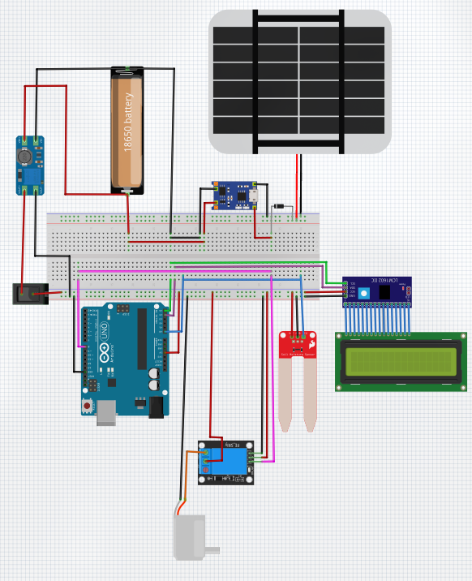

Na landing page, a seção "Projeto" apresenta o esquema com a explicação de cada bloco:

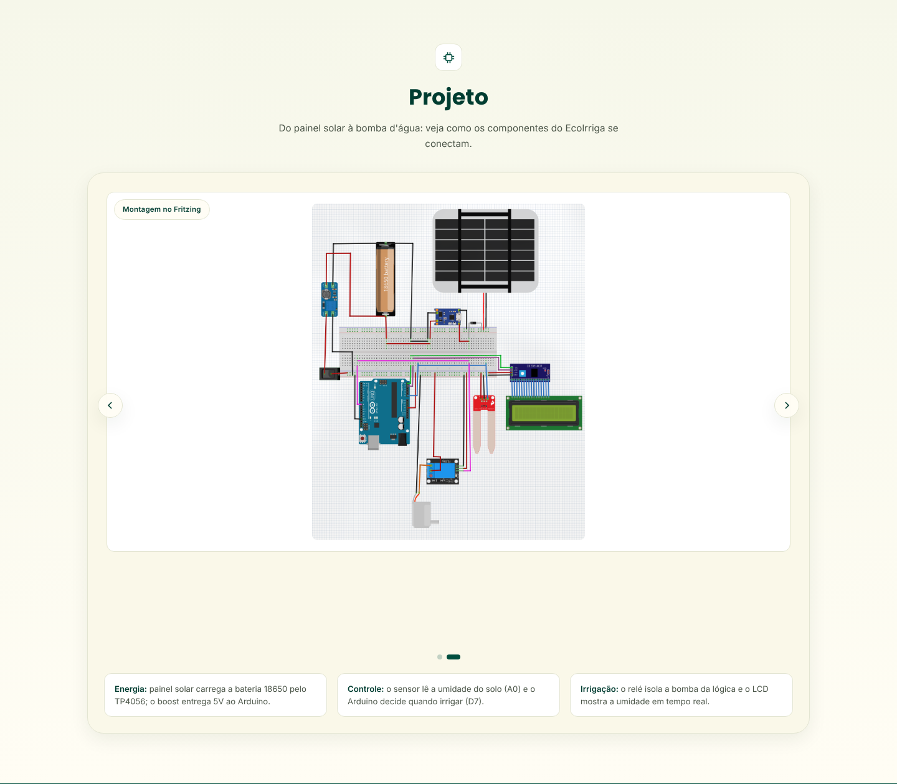

**Funcionamento:** o painel solar carrega a bateria pelo TP4056; o boost entrega 5 V ao Arduino. O Arduino lê a umidade no A0 e, quando o solo está seco, liga o relé (D7) para acionar a bomba. A umidade aparece no LCD em tempo real.

## Case 3D

Quatro peças em [`models/`](models): `Caixa`, `Estantes`, `Arco` e `Tampa` (arquivos `* Case SE.stl`), impressas em 3D. A landing page tem um visualizador (Three.js) com órbita, slider de explosão e chips para ligar/desligar cada peça.

### Visualizador 3D

| Montado | Explodido |
|---|---|
| 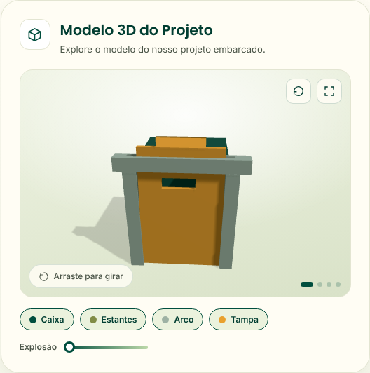 | 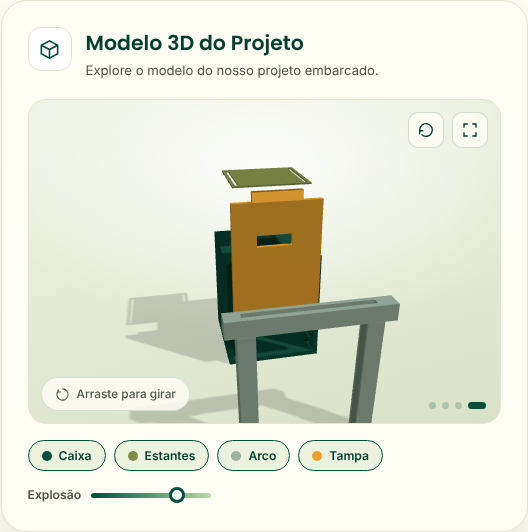 |

## Site e loja

- **Landing page:** `index.html`, `css/`, `js/` — HTML, CSS e JavaScript puros, responsiva, com gráfico em canvas (dados de previsão ilustrativos).

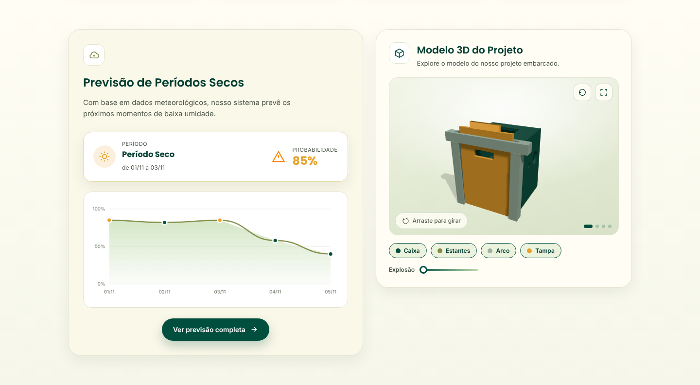
- **Loja (PHP + MySQL):** vitrine com busca e filtro, carrinho em sessão, checkout e confirmação de pedido.
### Loja

| Vitrine | Produto |
|---|---|
| 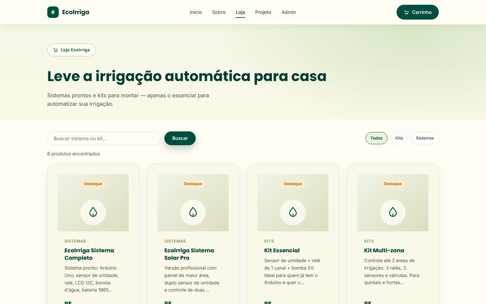 | 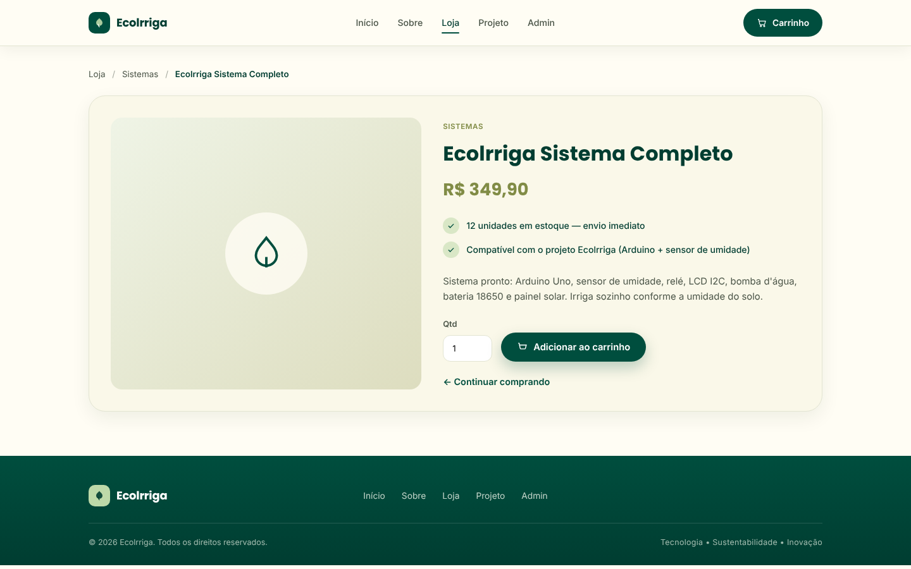 |

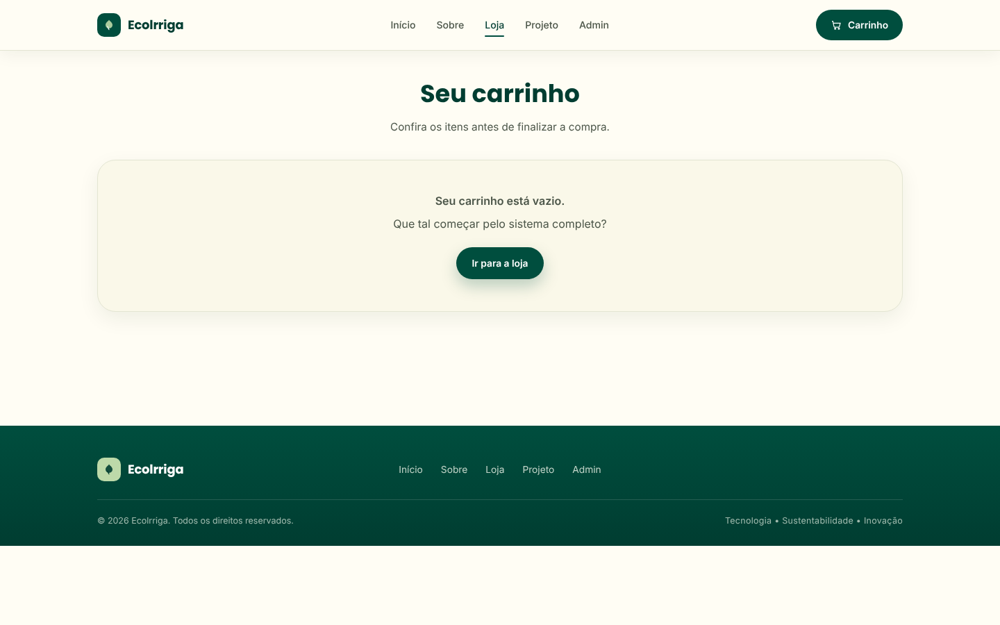

### Painel administrativo

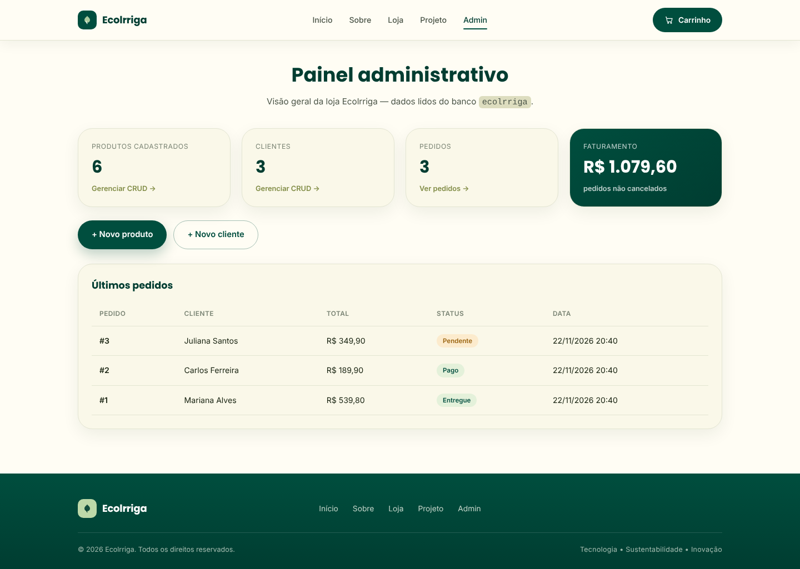

| CRUD de produtos | CRUD de clientes |
|---|---|
| 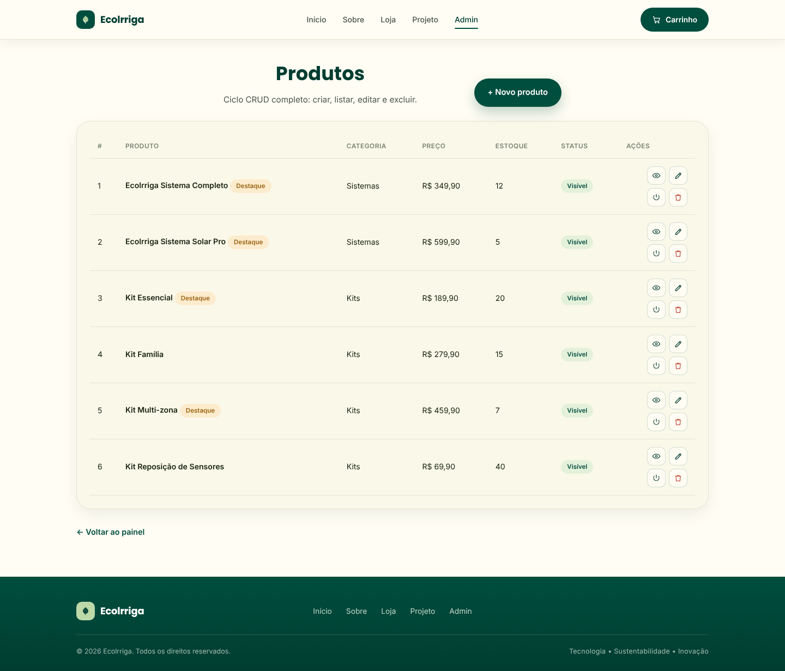 | 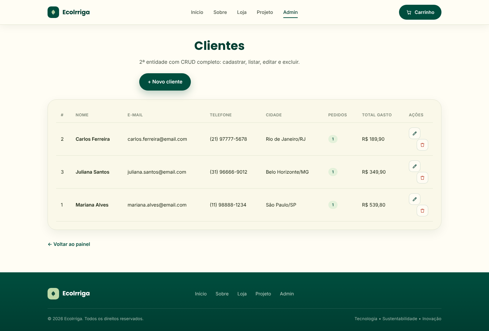 |

- **Painel admin:** dashboard com consultas agregadas, CRUD de **produtos** e **clientes** e atualização de status de **pedidos**.

### Banco de dados

Script completo em [`db/ecolrriga.sql`](db/ecolrriga.sql) (modelo lógico comentado + dados de exemplo).

| Relacionamento | Cardinalidade |
|---|---|
| `categorias` → `produtos` | 1:N |
| `clientes` → `pedidos` | 1:N |
| `pedidos` → `itens_pedido` | 1:N |
| `produtos` ↔ `pedidos` (via `itens_pedido`) | N:N |

### Segurança e integridade

- PDO com *prepared statements* (contra SQL Injection) e saída HTML escapada com `esc()` (contra XSS).
- O checkout grava cliente, pedido e itens em uma **transação** e dá baixa no estoque; se algo falhar, nada é gravado.
- Chaves estrangeiras: não é possível excluir cliente com pedidos nem categoria com produtos.

## Como rodar

Requisitos: Windows com **XAMPP** (PHP + MySQL).

```powershell
powershell -ExecutionPolicy Bypass -File serve-php.ps1
```

O script liga o MySQL, importa `db/ecolrriga.sql` e sobe o servidor em <http://localhost:8000>.

| Página | Endereço |
|---|---|
| Landing page | http://localhost:8000/index.html |
| Loja | http://localhost:8000/loja.php |
| Painel admin | http://localhost:8000/admin/index.php |

Só a landing page (sem PHP/banco): `powershell -ExecutionPolicy Bypass -File serve.ps1 -Port 8000`. Os STLs são carregados via `fetch`, então não abra o `index.html` direto pelo `file://`.

## Estrutura

```
index.html, css/, js/   Landing page e visualizador 3D
models/                 STLs do case
img/esquema.png         Esquema elétrico (Fritzing)
docs/img/               Capturas de tela usadas neste README
db/ecolrriga.sql        Banco de dados
config/, includes/      Conexão PDO e funções compartilhadas
loja.php, produto.php, carrinho.php, checkout.php, pedido.php
admin/                  Painel e CRUDs
serve.ps1, serve-php.ps1  Scripts para rodar localmente
```

## Equipe

[Nomes dos integrantes]
